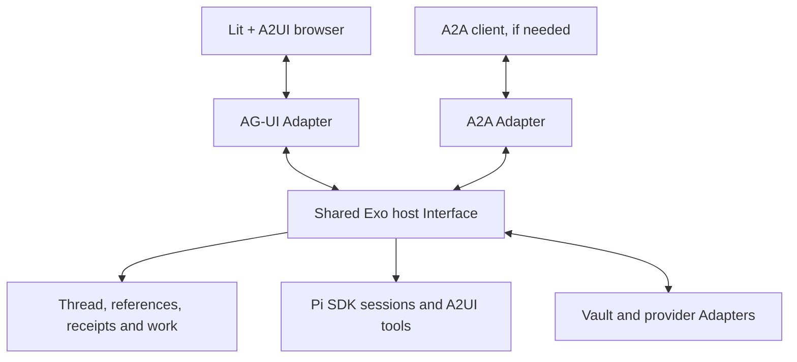

# A2UI input and two protocol Adapters over a shared Exo core

September 13, 2026. Source audit and architecture discussion following the [private control-convention audit](2026-09-13-private-control-convention.md). The user asks how visual actions become agent input and whether an A2A backend with an AG-UI frontend differs from independent protocol Adapters over one Pi-based core. This records known paths, new source findings and an open proposal. No package changes, runtime tests, new consensus or protocol adoption occurred.

**Answer:** The return path is known and exercised for bounded interactions under both protocols. Exo supplies their meaning to Pi explicitly. We previously considered a browser using both protocols and an AG-UI-to-A2A host bridge; a shared Exo/Pi core with sibling Adapters deserves its own explicit comparison. It avoids serial protocol translation, but does not eliminate either protocol's observation and recovery obligations.

## What A2UI sends back

In the pinned v0.9 family, a server-directed action carries a name, surface ID, source component ID, timestamp and resolved context. Input binding is local: typing does not automatically submit a request. An explicit action submits the relevant values; optional data-model synchronization can attach more client state. Local functions need not contact the agent. [A2UI actions and input synchronization](https://a2ui.org/specification/v0.9-a2ui/#client-to-server-messages).

For Exosurface, an illustrative action body is:

```json
{
  "name": "move",
  "surfaceId": "agenda-example",
  "sourceComponentId": "move-research-brief",
  "timestamp": "2026-09-13T14:00:00Z",
  "context": { "objectId": "research-brief", "revision": 17 }
}
```

The action name, object ID and revision semantics belong to Exo. Thread identity, logical request identity, authenticated caller and any associated utterance also need an explicit mapping. A timestamp alone does not establish causal order or which source revision the person saw. A local gesture becomes a durable turn when it communicates meaning under the product's interaction policy; every keystroke need not become a turn or model invocation.

## Actual return paths in the independent spikes

| Step | A2UI over A2A | A2UI over AG-UI |
| --- | --- | --- |
| Renderer input | Lit's MessageProcessor calls the browser action handler. | The same renderer calls the browser action handler. |
| Client envelope | `sendIntent` builds an A2UI action list in an `application/a2ui+json` DataPart and uses `sendMessage`. A text Part can accompany it; contextId identifies the known thread. | `runAgent` sends `forwardedProps.a2uiAction`, requestId, mode and optional utterance. threadId identifies the known thread. This spike uses an Exo envelope, not the optional middleware's exact wrapper. |
| Host input | The executor parses the A2UI client-message list, joins text Parts and calls `thread.intent`. | The route parses the A2UI action, checks the recorded offered action, constructs an Exo Command and calls `host.command`. |
| Dispatch | Selection is recorded; move produces a deterministic proposal; accept/light execute host logic. `ask` starts Pi-backed work. | Selection/accept/light execute host logic. Plan/move/ask can start independent work; mode selects deterministic execution or Pi. |
| Model input | `projectContext` includes the authored contribution, exact historical A2UI/reference, current sources/proposals and relevant turns. `session.prompt` receives serialized JSON. | `host.context` includes current state, exact historical source/A2UI/reference and recent authored turns. `executePi` passes serialized JSON to `session.prompt`. |
| Return to the surface | Validated Pi output and host changes enter the Exo thread; the observation path publishes A2UI with checkpoints. | Host changes enter the Exo thread; the observer publishes state and A2UI activity updates. |

This shows a structured interaction-to-context path, not automatic visual understanding from a protocol. Neither inspected Pi path supplies rendered screenshots. Both preserve structural/semantic context; richer visual perception is a separate model-input choice. Their current per-job in-memory Pi sessions do not demonstrate one continuously shared Pi session with concurrent steering.

Current A2UI documentation also describes client action lists in A2A DataParts. That public page now describes v0.9.1; the spikes remain on their reviewed v0.9/renderer pins and their envelope code is the evidence for what actually ran. [A2UI A2A client events](https://a2ui.org/specification/v0.9.1-a2ui-extension-specification/#client-to-server-events). AG-UI's published RunAgentInput provides forwardedProps as an application payload carrier. [AG-UI input types](https://docs.ag-ui.com/sdk/js/core/types).

## Middleware reuse and limits of the proof

The previously inspected official AG-UI A2UI middleware reads `forwardedProps.a2uiAction.userAction` and appends a synthetic assistant tool call and tool result describing the action. It is an optional model-input conversion. Our spike sends the raw action at `forwardedProps.a2uiAction` and projects Exo history itself; substituting the middleware without mapping that wrapper would not perform the conversion. A Pi binding would also have to consume the transformed messages. [Pinned middleware implementation](https://github.com/ag-ui-protocol/ag-ui/blob/747933694b05676203da7d5bb8d8e50432e59b75/middlewares/a2ui-middleware/src/index.ts#L232), [payload types](https://github.com/ag-ui-protocol/ag-ui/blob/747933694b05676203da7d5bb8d8e50432e59b75/middlewares/a2ui-middleware/src/types.ts#L101).

If used, that synthetic tool representation belongs in the model projection; preserve the original person's contribution in the Exo thread. It must not make the archive claim that the agent authored the user's action. It also does not supply exact historical lookup, durable deduplication, authorization or proposal semantics. The earlier finding that run middleware is bypassed on the inspected connect path still needs accounting when using it for background output.

| Source finding | Scope and consequence |
| --- | --- |
| A2A reconstructs the renderer action | `client/app.ts` retains action name/context/surface but drops the original sourceComponentId and timestamp. `sendIntent` substitutes objectId or action name as component ID and creates a new timestamp. Preserve the original event when normalizing it; a task ID is not a component ID. |
| A2A validates semantic intent, not the exact offered component action | The host checks schema, thread/surface revision, object and proposal rules. It does not compare the original component/event against the saved A2UI tree. This is an owned input-validation gap, not an A2A limitation. |
| AG-UI preserves the original event through HTTP validation, then reduces it | The route checks component/action context against saved operations, then constructs a Command without the original component ID, timestamp or complete resolved context. Command/Turn schemas do not retain that event. Its exact JSON comparison covers literal fixtures; generalized resolved form/data-bound validation remains unproved. Generic command inputs use a separate host validation path. |
| The spikes exercise different action policies | A2A's move is a fixed host rule; AG-UI can invoke Pi for moves. Both need a common dispatch policy before attributing differences to protocols. A2A's generated reflection permits no action components; broad model-generated action round trips remain unproved. |
| General interaction and active-session input remain open | Neither spike establishes arbitrary drag/edit/forms, complete data-model synchronization, live voice association, or a shared Pi session's steering/follow-up policy. AG-UI's Pi Adapter also still requires an utterance in its output. |

These are source findings against recorded proof scope, not newly executed failing cases. A normal user action need not map to an A2A Task or an AG-UI interrupt resume. Exo decides whether to record it, run deterministic logic, start work or address ongoing work. Mandatory acceptance/retry/cancellation checks still apply.

The subsequent [shared-core coverage check](../shared-core-protocol-mapping.md) narrows the earlier AG-UI preservation claim: `src/server.ts:108–155` preserves the event for validation but passes only the constructed Command into the host; `src/domain.ts:32–67` has no original-action field in Command or Turn. Both spikes therefore need original-event preservation through the authored archive, despite losing it at different stages. This is an additional source inspection, not a new runtime failure test.

## Three distinct ways to combine the protocols

| Topology | What communicates with what | Benefit | Additional responsibility |
| --- | --- | --- | --- |
| Split browser | Browser uses AG-UI for publications and A2A for work controls. Both reach Exo. | Browser can consume each protocol's native contribution. | Browser correlates receipts, tasks, publications and errors across two paths. |
| AG-UI frontend with A2A backend | Browser speaks AG-UI; a host bridge converts input/output and controls to/from an A2A-facing backend. | Reuses an existing independently useful A2A backend while keeping one browser protocol. | Bridge translates action envelopes, identities, lifecycle, errors and observation. AG-UI still needs a client convention exposing remote cancel/query operations. |
| Shared Exo/Pi core with sibling Adapters | A2A and AG-UI endpoints independently call one Exo Interface. Neither calls through the other. Clients choose the endpoint they need. | Shares execution, semantic context, receipts, source rules and publication ordering without an AG-UI-to-A2A translation stage. | Maintains two protocol mappings and their lifecycle conformance; enabling both requires mixed-client validation. |

The third is **shared implementation**, not protocol tunneling. A browser can speak only AG-UI while an independent caller speaks A2A to the same core. Having an A2A endpoint beside it does not give the AG-UI browser native CancelTask/GetTask semantics; its actions still need the chosen Exo client contract. A bridge is justified by a backend/consumer it actually reuses; it is not needed merely to share work-control code.



The diagram is an unselected architecture proposal. Either endpoint could be the initial browser path; its presence in the drawing does not commit to delivering both.

## What should actually be shared

The shared Module is the **Exo host built around Pi**, including durable conversation and job behavior. Reusing only `createAgentSession` while each endpoint maintains separate turns, receipts, queues and snapshots would duplicate the important Implementation.

| Shared core owns | Protocol Adapters own |
| --- | --- |
| Authenticated caller scope, normalized intent, original A2UI action provenance and revision validation | Credential/envelope decoding and translating protocol identity into core caller/thread references |
| One logical request/turn/work identity, receipts and admission policy | Mapping A2A Messages/Tasks or AG-UI run/message/activity IDs to those identities |
| Queue/steer/follow-up/cancel policy and truthful outcomes | Standard cancel/error or Exo acknowledgement encoding; transport abort stays separate |
| Exact historical references, context projection, Pi tools and source-authority rules | Carrying contributions without redefining their authorship or meaning |
| Recoverable current state and ordered publications | A2A observer Task mapping or AG-UI publication framing, connection leases, backpressure and teardown |

The proposed Exo Interface can stay small: submit intent, observe current/thread changes, cancel work, inspect exact history and query work where a caller needs it. It must specify receipts, ordering, concurrency, retention and failure behavior as well as method shapes. Native SDK machinery remains inside the Adapters; no replacement protocol SDK is proposed.

Pi supports custom tools, extension factories, event subscriptions and queued steering/follow-up. Those are useful integration points, not a supplied durable Exo host or a guarantee that an extension bus replays after disconnect. The installed 0.85.1 SDK docs and inspected spike usage support this packaging direction. [Pi SDK documentation](https://github.com/earendil-works/pi/blob/main/packages/coding-agent/docs/sdk.md).

**Packaging proposal:** Keep endpoint registration, observer lifetime and durable host ownership at process scope. Pi extensions can contribute A2UI tools and context hooks. A host plugin may install either protocol Adapter, but opening/replacing a Pi session should not create another server, disconnect viewers or duplicate subscriptions. Calling everything a Pi extension does not settle that lifetime distinction.

## Assessment and next evidence

The primary-agent preference is to explore the shared Exo core with sibling Adapters if both protocols have a useful caller. It preserves one authoritative thread and avoids serial protocol translation. That is a Module-shape preference, not a decision to ship both. Initial v1 can still expose one selected protocol over that core; additional machinery must earn its place.

“Minimal” is an objective, not yet measured. Sharing the core removes duplicate domain behavior, while the independent spikes already show substantial protocol-specific observation work. Two Adapters still cost more to support than one unless their reused capabilities justify it. Their single-protocol scores cannot be added or averaged to rate this topology.

A bounded future check should deliver the same original A2UI action through each Adapter, with the same request ID and historical reference, and assert one canonical contribution/receipt and equivalent Pi context. If both endpoints run simultaneously, include two concurrent mixed-protocol accept/cancel requests and a slow observer alongside an advancing observer. Define the currently running Pi session's input policy. These checks complement the standing background, source-authority and capacity gates; they are not newly executed or scheduled by this note.

## Evidence pins

- A2A commit `8af5351d896adcc22f8046e58521d3692f3be53a`, package `spikes/a2a-pi`: `client/app.ts:72`, `src/client.ts:30`, `src/host.ts:147`, `src/thread.ts:88`, `src/pi.ts:15`, `src/surface.ts`.
- AG-UI commit `add66812b20bcf20e6189cfd9c1c1c8b4bb2e2fa`, package `spikes/ag-ui-pi`: `src/browser.ts:350`, `src/server.ts:105`, `src/host.ts:176`, `src/host.ts:456`, `src/pi.ts:131`.
- Existing execution scope and unpublished-branch provenance: [post-spike evidence record](2026-09-13-spike-debate.md#evidence-provenance). The source audit does not expand those runtime claims.

The current scorecard, W4 follow-up and exact ratified statement remain unchanged. No final protocol, shared-core package, Pi session policy or deployment is selected.
