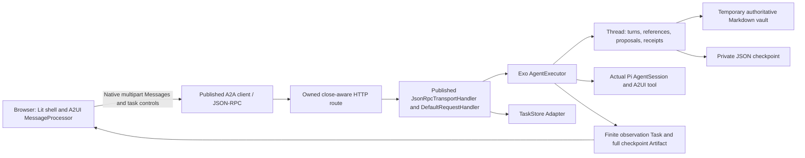

# Exosurface: A2UI over A2A + Pi

An independent, runnable spike of Exosurface as a temporal multimodal conversation. An agenda, direct selections, accepted decisions, simulated lights, optional utterances, and Exo's visual responses belong to one durable thread. The browser uses the published A2A client and published Lit/A2UI renderer. The custom Exo host runs the actual Pi SDK.

This package has its own manifest, lockfile, host, client, fixtures and tests. It does not import executable code or state from another spike or the repository root. It does not select the project's final protocol. Read [the evidence report](evidence/REPORT.md) for bounded results and unresolved requirements.

## Run

From this directory, with Node 22 or newer and npm:

```sh
npm run setup && npm start
```

Open <http://127.0.0.1:61011>. The A2A host listens on loopback port **61001**. `setup` installs the exact lockfile and local Playwright Chromium. The tested environment was Node **26.0.0**, npm **12.0.1**, macOS arm64. Other supported Node versions are not separately validated.

`npm start` creates a temporary fixture vault and starts background work before any browser attaches. Its console output gives the state directory. For a fresh independent run:

```sh
npm start -- --state /tmp/exo-a2a-my-run
```

The default `/tmp` equivalent is the operating system temporary directory plus `exosurface-a2a-pi-demo`; restarting with that directory restores the thread. Use a different directory to start a new thread. `--host-only`, `--port 61001`, and `--boot-work-ms 60000` support host-only and long-work demonstrations. The browser accepts `?host=http://127.0.0.1:PORT`; its own development port remains 61011.

Try these interactions:

1. Open two tabs. Choose **After lunch** beside Research review, then **Use this version** from either tab. Both display the accepted 13:00 plan. The fixture's original `Agenda.md` remains authoritative; acceptance creates one Markdown record under `vault/Plans/`.
2. Toggle the simulated studio light. The other tab sees the same outcome.
3. Select a task. Optionally open **Add words to this turn**, enter “Move this after lunch,” and choose **Propose with selection**. The object and original revision remain attached to the contribution.
4. Edit `vault/Agenda.md` in the printed temporary directory while the browser is idle. The current agenda changes and pending proposals become stale. Click a thread turn to inspect its preserved visual revision.
5. Use **Detach observer**, or close all tabs. Work continues. Reconnect or restart the host with the same state directory to restore current work, history and decisions.
6. With an existing Pi provider already configured, choose **Ask Exo through Pi**. Empty optional language permits a purely visual contribution. An inspected historical revision becomes the reference for Pi's next response.

The demo has fixed fixture identities: `demo-owner` and `demo-outsider`. These illustrate host authorization on loopback; they are not production authentication. No provider credentials are sent to the browser. No physical devices, live calendar writes, voice migration, deployment or SQLite are involved.

## Verify

```sh
npm run validate
```

This runs strict TypeScript checking, eleven Node tests, a production browser build and three real Chromium scenarios. Tests use temporary vaults and actual A2A HTTP transport. The restart test kills only its own launched child process after a real Markdown write. The stall test uses a local forwarding proxy to suppress observation bytes without closing the socket. Those fault injectors do not replace the SDK, Pi or renderer.

Actual model validation is separate because it uses the operator's already configured provider:

```sh
npm run test:model
```

It runs two actual Pi sessions, renders their generated A2UI in Chromium, restarts the host between sessions, and checks historical/current references. It resolves native Pi credentials in place and reads the existing default provider/model settings; it neither provisions credentials nor changes provider setup. No available model produces a failed test with the prerequisite stated. Deterministic tests never count as model proof. Both 61001 and 61011 must be free for this command; it may take a few minutes and uses the configured model's normal allowance.

Generated measurements, screenshots and model evidence go to ignored `evidence/generated/`. Reviewed artifacts from the recorded run are in [evidence/observed/](evidence/observed/). No browser profile, credentials, hidden reasoning, raw provider exchange or dependency directory is committed.

## Versions and upstream guidance

| Dependency / wire | Pin | Why this combination |
| --- | --- | --- |
| `@a2a-js/sdk` | 1.1.0 | Published A2A 1.0 client, codecs, request handler, executor/store/event bus Interfaces, JSON-RPC handler and SSE formatter. |
| A2A transport | 1.0 JSON-RPC + SSE | Standard `SendMessage`, `SubscribeToTask`, `GetTask`, `ListTasks`, `CancelTask`; native direct Messages for ordinary turns. |
| `@a2ui/lit`, `@a2ui/web_core` | 0.11.0 each | Current compatible published pair, with the same exported v0.9 processor and basic catalog on host and browser. Package 0.11 is not a claim of protocol v0.11. |
| A2UI format / binding | v0.9 | Documented `application/a2ui+json` DataPart array and extension URI; approved basic catalog `https://a2ui.org/specification/v0_9/catalogs/basic/catalog.json`. |
| `@earendil-works/pi-coding-agent` | 0.85.1 | Current official Pi namespace and supported `ModelRuntime`, `createAgentSession`, isolated resource loader, extension tools and session lifecycle. |

Other direct dependencies are pinned exactly in [package.json](package.json); all transitives have lockfile integrity hashes. No patches, forks, overrides or copied SDK implementations are used. The A2A application route is owned code around supported public transport APIs, and its maintenance is counted explicitly in the report.

Primary sources inspected before implementation:

- [A2A 1.1.0 README](https://github.com/a2aproject/a2a-js/blob/v1.1.0/README.md) and [published request-handler source](https://github.com/a2aproject/a2a-js/blob/v1.1.0/src/server/request_handler/default_request_handler.ts).
- [A2UI v0.9 A2A binding](https://github.com/a2ui-project/a2ui/blob/1c45c809b655878d06e3afc6dda22100afecc0a4/specification/v0_9/docs/a2ui_extension_specification.md).
- [Official DirectJsonPromptGenerator](https://github.com/a2ui-project/a2ui/blob/1c45c809b655878d06e3afc6dda22100afecc0a4/agent_sdks/python/a2ui_agent/src/a2ui/inference_formats/direct_json/prompt_generator.py) and [SkillGenerator](https://github.com/a2ui-project/a2ui/blob/1c45c809b655878d06e3afc6dda22100afecc0a4/agent_sdks/python/a2ui_agent/src/a2ui/skill/generator.py). These are Python-oriented generation guidance, not a ready-made Pi plugin. The spike derives schemas from the installed renderer catalog, uses the upstream tool convention `send_a2ui_json_to_client` and root-first guidance, and validates every generated component. Raw tool arguments do not require the textual `<a2ui-json>` delimiter used by text-generation examples.
- [Current official Pi SDK documentation](https://github.com/earendil-works/pi/blob/main/packages/coding-agent/docs/sdk.md), checked against the installed 0.85.1 artifact and bundled examples.
- [Obsidian Bases syntax](https://obsidian.md/help/bases/syntax) for the temporary Markdown/frontmatter/`.base` arrangement. A real Obsidian application and the user's live vault are outside this test.

## Ownership and composition



[Thread](src/thread.ts) is the deep domain Module: it owns revisions, authored contributions, source authority and acceptance. [Host](src/host.ts) composes that Module with A2A executor/store/transport Adapters. [Pi](src/pi.ts) deliberately projects current and historical meaning into an isolated Pi session, then validates generated UI through [the catalog boundary](src/surface.ts). [The client](client/app.ts) applies live Artifacts through one ordered processor and uses a separate inert processor for historical rendering.

An agenda task ID is a source object. An A2A Task ID is execution or observation. The A2A context identifies the thread. A surface incarnation survives work executions; revision IDs identify meaningful visual history. A person/Exo/source Turn has its own ID, optional `utteranceId`, exact reference and causal `respondsTo`. A Pi session is one execution, rebuilt from a deliberate projection of the durable thread rather than presumed to be that thread.

The important result is viability through supported APIs for the recorded bounded scenarios. Reliable background observation is **added application support**, even though all dependencies remain unchanged. The evidence report enumerates that support and the tests it needs on future SDK upgrades.
